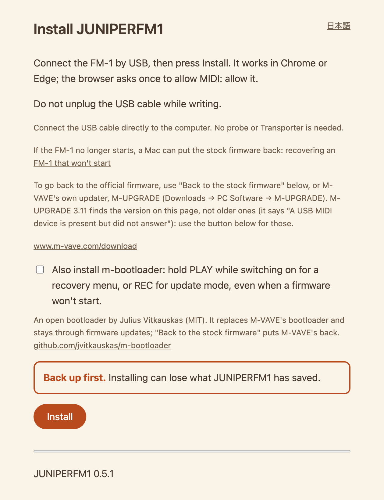

# JUNIPER FM-1

A six-voice polysynth firmware for the M-VAVE FM-1, built on
[fm1-base](https://github.com/charlesvestal/fm1-base) (commit `2bb8e74`). A polysynth inspired by the Juno-106.
Unofficial: not affiliated with or endorsed by Roland or M-VAVE. The engine is written from scratch from the Juno-106's
published design. It contains no code or data from Roland, Cherry Audio or any other emulation.

**Release 0.5.1.** 128 factory patches (see [PRESETS.md](PRESETS.md)).

- **Play it in your browser:** https://fergroan-sketch.github.io/juniper-fm1/play/ (the real firmware on
  [fm1-emu](https://joakimeriksson.github.io/fm1-emu/), an emulated FM-1).
- **Install it:** https://fergroan-sketch.github.io/juniper-fm1/install/ (Chrome or Edge, FM-1 on USB), or see
  "Installing" below.
- **Download:** the `.fwsc` is on the [releases page](https://github.com/fergroan-sketch/juniper-fm1/releases).

## The sound

Per voice: DCO (saw, pulse with PWM from LFO / manual / envelope, sub-octave square, noise, 16'/8'/4'), then a
resonant four-pole low-pass (self-oscillates at the top of RES) with envelope (+/-), LFO and keyboard follow, then the
VCA (ENV or GATE). After the voices: the high-pass (0 bass boost, 1 flat, 2, 3), then the stereo chorus (OFF, I, II,
I+II). One ADSR, one triangle LFO with delay. Ranges follow the Juno-106 service notes' specifications (LFO 0.1 to
30 Hz, delay 0 to 3 s, DCO LFO +-400 cents, cutoff 5 Hz to 50 kHz, envelope +-14 octaves, LFO and bender +-3.5
octaves, attack 1.5 ms to 3 s, decay and release 1.5 ms to 12 s).

Additions, following superOS-106's manual:

- Voice modes: POLY 1, POLY 2, MONO (note memory: a release returns to the highest key held), CHORD (chord memory,
  up to six notes), UNISON (with UNI DET spread), DUAL (each note on a pair of voices). 6 voices by default, 1 to 10.
- Arpeggiator: off, on, on with hold; up, down, up/down, as played; one to three octaves; first-note offset; rate
  2 to 32 steps a second, gate length; internal clock, MIDI clock (sixteenths), or auto.
- Velocity to amp, filter or both, with depth (it only takes away: full velocity gives the panel setting).
- Envelope 2: the filter on its own ADSR.
- VOICE page: per-voice detune, vibrato and PWM, from the panel LFO or a detune LFO of its own; drift.
- LFO sync to MIDI clock (1/16 to a bar). Scales: equal, Arabic (maqam Rast), four user scales by SysEx.
- Voice mode, unison detune, envelope 2, the voice page, drift and the chord are saved with each patch.

## The controls

| Button | Page | K1 | K2 | K3 | K4 |
| --- | --- | --- | --- | --- | --- |
| HOME | the patch | FREQ | RES | VCF ENV | CHORUS |
| EDIT | DCO | LFO | PWM | SUB | NOISE |
| EDIT 2nd | DCO 2 | RANGE | PWM MODE | SAW | PULSE |
| EDIT 3rd | VOICE | voice 1-6 | DETUNE | VIBRATO | PWM LVL |
| SEL | VCF | FREQ | RES | ENV | LFO |
| SEL 2nd | VCF 2 | KYBD | ENV POL | HPF | |
| ENV | ENV | A | D | S | R |
| ENV 2nd | ENV 2 (VCF) | A | D | S | R |
| ENV 3rd | VCA | MODE | LEVEL | ENV 2 on | |
| LFO | LFO | RATE | DELAY | DCO LFO | VCF LFO |
| LFO 2nd | LFO 2 | SYNC | DET LFO | DRIFT | |
| FX | CHORUS | CHORUS | HPF | LEVEL | |
| GLO | VOICE MODE | MODE | VOICES | UNI DET | PORTA |
| GLO 2nd | VELOCITY / BEND | VEL TO | VEL DEPTH | BEND | BEND VCF |
| GLO 3rd | SCALE / CLOCK | SCALE | CLOCK | FIRST (arp) | |
| GLO 4th | MIDI | MIDI CH | LOCAL | | |
| ARP | ARPEGGIO (each press: off, on, hold) | ORDER | RANGE | RATE | GATE |

PRESET or SELECT: next/previous patch. ALGO: jump 8 patches. PLAY: chord memory, the next chord you play is kept
(and the mode becomes CHORD). SAVE: store the patch (lit when edited). OCT-/OCT+: octave. REC held a second:
Bluetooth on/off. 128 patches, A01 to B64, all factory patches made for this firmware ([PRESETS.md](PRESETS.md)).
An arp patch (A15 to A27) starts the arpeggiator; a chord patch plays its stored chord from one key.

## MIDI

In (USB, Bluetooth, TRS) and out (USB, Bluetooth):

- Notes, pitch bend, mod wheel (LFO to DCO), sustain, CC 120/123, program change 0 to 127.
- superOS-106's controller numbers for the sliders: 76 LFO rate, 78 LFO delay, 77 DCO LFO, 12 PWM, 14 sub,
  13 noise, 74 cutoff, 71 resonance, 16 VCF env, 17 VCF LFO, 18 key follow, 7 VCA level, 73 A, 75 D, 79 S, 72 R.
  Also 22 voice mode, 38 to 41 envelope 2 ADSR, 42 envelope 2 on, 102 to 107 voice detune, 108 to 113 voice
  vibrato, 114 detune LFO speed, 122 local control. Turning a knob sends its CC.
- MIDI clock, Start, Continue, Stop (arpeggiator and LFO sync).
- SysEx over USB: the Juno-106's own messages (F0 41 30 patch into a slot, 31 the manual patch, 32 one
  parameter), so Juno-106 librarians and editors can send patches; superOS-106's user scale message
  (F0 41 3D 0n 02 ss ...). A patch change sends F0 41 30, a switch change sends F0 41 32.

## Layout

    app/juno.c, juno.h   the engine (pure C, float; runs on the FM-1 and on a computer)
    app/app.c, app.h     the FM-1 app: pages, knobs, patches, MIDI
    app/fm1.toml         build settings
    app/tests/           host simulator scripts (basic, features, arp_patch and sysex_slot check; demo.txt renders every factory patch)
    host/render.c        a standalone engine renderer for quick listening tests
    tools/bank.txt       the factory bank, one patch a line; tools/mk_factory.py makes app/factory.h from it
    tools/make_pages.sh  the GitHub Pages site (site/: installer, firmware, play/)

## Building

Put this repository beside fm1-base (at `2bb8e74`, with its toolchain in `fm1-base/.toolchain`). From the folder
that holds both:

    sh juniper-fm1/build.sh host     # the host simulator and its checks
    sh juniper-fm1/build.sh          # the firmware: juniper-fm1/app/build/juniperfm1.fwsc

Docker Desktop must be running. With `ble = true` the build needs more of JieLi's AC79 SDK than fm1-base's setup
fetches; the script points `AC79_SDK` at `fm1-base/.toolchain/ac79-sdk-full`, where those folders were fetched.

Elsewhere: `git clone --recursive https://github.com/charlesvestal/fm1-base`, then `tools/setup_toolchain.sh` in it
(on a Mac the toolchain runs in Docker or Podman).

## Installing

Back up your FM-1 first: installing can lose what is saved on it. Then open
https://fergroan-sketch.github.io/juniper-fm1/install/ in Chrome or Edge. Offline, on a Mac, double-click
**Open JUNIPER installer.command**: it serves `site/` on http://localhost:8106 and opens the installer in Chrome (or
Edge). Connect the FM-1 by USB, press **Install**, and allow MIDI when the browser asks. Do not unplug the cable while
it writes. The same page can put M-VAVE's stock firmware back ("Back to the stock firmware").

The package is also in `site/firmware/juniperfm1-0.5.1.fwsc`, for fm1-base's command-line installer:
`python3 tools/fm1_install.py juniperfm1-0.5.1.fwsc`.

On its first start, 0.5 loads its factory bank in place of any bank saved by 0.2 to 0.4. 0.5.1 installs over 0.5
(the same package identity) and keeps what 0.5 saved: its two level changes reach a slot only if that block was never
saved.
