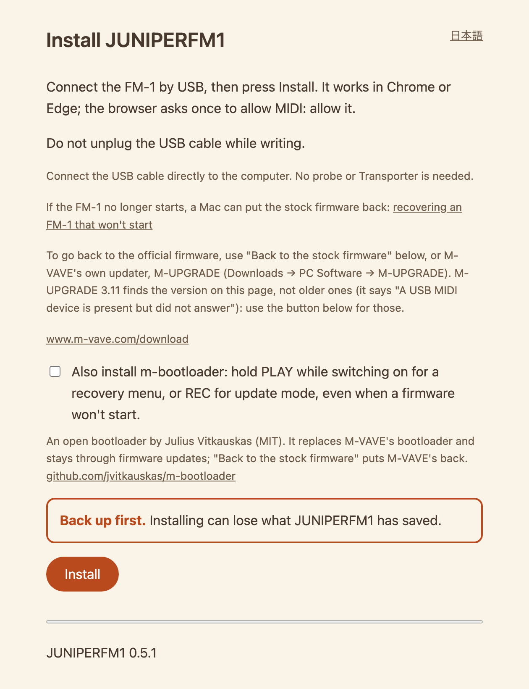

# JUNIPER FM-1

JUNIPER FM-1 is a six-voice polysynth firmware for the M-VAVE FM-1: one DCO per voice with saw, pulse/PWM, sub and
noise, a high-pass, a resonant four-pole low-pass, one ADSR, an LFO with delay, and a stereo chorus (I, II and I+II).
It has 128 factory patches, with arpeggios and chords stored in the patches. A polysynth inspired by the Juno-106.

This is version {{VERSION}}. You install it at your own risk, and the installer can put M-VAVE's own firmware back.

- [Play it in your browser](play/): the real firmware on an emulated FM-1.
- [Install](install/) it from Chrome or Edge, with the FM-1 connected by USB.
- [Download {{PKG}}](firmware/{{PKG}}) to use the command-line installer: `python3 tools/fm1_install.py {{PKG}}`.
- [Source on GitHub](https://github.com/fergroan-sketch/juniper-fm1), under MPL-2.0. It's built on fm1-base and
  felucca-bsp, which come from Felucca by Leo Kuroshita, Hügelton Instruments.

Unofficial: not affiliated with or endorsed by Roland or M-VAVE. M-VAVE and FM-1 are trademarks of their owners.
