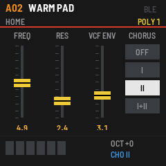
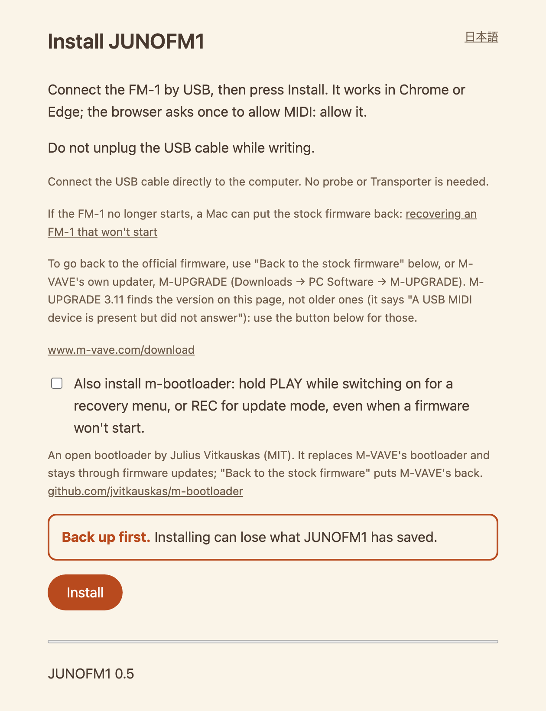

# JUNO FM-1

JUNO FM-1 is a six-voice polysynth for the M-VAVE FM-1 in the style of the Roland Juno-106: one DCO per voice with
saw, pulse/PWM, sub and noise, a high-pass, a resonant four-pole low-pass, one ADSR, an LFO with delay, and the
stereo chorus I, II and I+II.

This is version {{VERSION}}. You install it at your own risk, and the installer can put M-VAVE's own firmware back.

- [Install](install/) it from Chrome or Edge, with the FM-1 connected by USB.
- [Download {{PKG}}](firmware/{{PKG}}) to use the command-line installer: `python3 tools/fm1_install.py {{PKG}}`.
- The source is under MPL-2.0. It's built on fm1-base and felucca-bsp, which come from Felucca by Leo Kuroshita,
  Hügelton Instruments.

Roland, Juno-106, M-VAVE and FM-1 are trademarks of their owners. JUNO FM-1 is unofficial and not affiliated with
Roland or M-VAVE.
